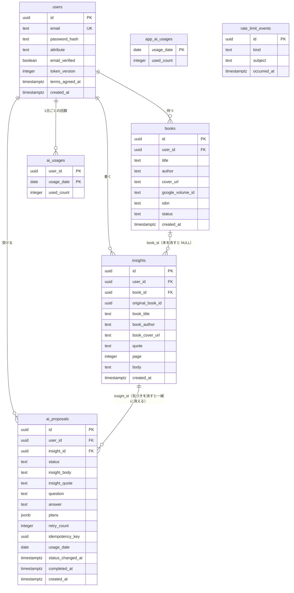

# データベース設計（database.md）

SHIORIME のテーブル・列・制約・インデックスを決める文書。要件は [要件定義書](../requirements.md)、API は [api.md](api.md)、技術的な決定事項は [notes.md](notes.md) を参照。

## 1. テーブルの一覧

| テーブル | 1行が表すもの | つながり |
| --- | --- | --- |
| `users` | 利用者1人 | ― |
| `books` | ある利用者の本棚の本1冊 | `users` |
| `insights` | 気づき1つ | `users`・`books`（本を削除すると `NULL`） |
| `ai_proposals` | AI提案1つ | `users`・`insights` |
| `ai_usages` | ある利用者の、ある日（日本時間）の AI の利用回数 | `users` |
| `app_ai_usages` | アプリ全体の、ある日（日本時間）の AI の利用回数 | なし（誰が使ったかを持たない） |
| `rate_limit_events` | 回数制限の対象になる操作1回 | なし（IP か利用者 ID を文字として持つ） |

- 1つの「もの」につき1つのテーブル。本棚は「`user_id` が自分の本」がそのまま本棚になるので、入れ物のテーブルは作らない（1人に本棚は1つ）。
- ほかのテーブルから数えて作れるもの（気づき一覧の本ごとのまとまり、気づきの件数）はテーブルにしない。同じ情報を2か所に持つと、片方だけ更新し忘れてずれるため（正規化）。気づきに持たせる本の題名・著者・表紙の写しは、本を削除した後も残すための意図的な例外（非正規化）。
- AI の利用回数の2つのテーブルは、使われるたびに行を足すのではなく、1日1行で回数の数字を+1していく。上限の確認と+1を1回の命令でまとめやすいため。
- つながっている相手が消えたときの動き（参照アクション）：
  - `insights.book_id` → `books`：本が消えたら `NULL` にする（`ON DELETE SET NULL`）。気づきは残す。
  - `ai_proposals.insight_id` → `insights`：気づきが消えたら一緒に消す（`ON DELETE CASCADE`）。
  - `books`・`insights`・`ai_proposals`・`ai_usages` の `user_id` → `users`：退会したら一緒に消す（`ON DELETE CASCADE`）。

## 2. 全テーブル共通の決まり

### 2-1. 主キー（ID）

- 主キーは UUID v7 にし、PostgreSQL の `uuidv7()` で自動で作る（`id uuid PRIMARY KEY DEFAULT uuidv7()`）。PostgreSQL は 18 以降を使う。
- UUID にする理由は api.md 1-2（連番だと他人の ID を推測されやすく、件数も読み取れる）。
- v4（全部でたらめ）ではなく v7（前半が作った時刻）にする理由：テーブルの行はどちらも末尾に足されるが、主キーのインデックスは値の順に並ぶ。v4 は新しい ID がインデックスの途中に割り込み、データが増えるとページ分割とディスクの読み込みが増えて書き込みが遅くなりやすい。v7 は値の順＝作った順なので、常にインデックスの末尾に足すだけで済む。今の規模では差は出ないが、ID の作り方は後から変えるとつながっているテーブルと URL を全部作り直すことになるため、最初から増えても困らない方を選ぶ。
- v7 は ID から作った時刻がわかるが、作った日時は画面にも出していて隠す情報ではない。後半の約74ビットはランダムで、他人の ID を当てるのは事実上できない。
- データベースで作る理由：アプリ・テストのデータ作り・手作業の SQL のどこから行を足しても同じ作り方になるため。作った ID は `INSERT … RETURNING id` で受け取る。
- 並び順には ID を使わず、作成日時の列を使う（v7 の時刻はミリ秒単位で、同じミリ秒の中の順番は保証されないため）。ID は、同じ日時のときの順番を決めるため（タイブレーカー）にだけ使う。

### 2-2. 日時

- 日時の列はすべて `timestamptz` にする。値は UTC で保存し、「今日」の判定（AI の回数など）と画面の表示のときだけ日本時間に直す（notes.md「共通」）。
- 理由：`timestamp` は渡された数字をそのまま覚え、どこの国の時刻かを持たない。サーバーの時刻の設定や、Python と PostgreSQL の時刻の基準が違うと、日本時間と UTC の値が混ざっても見分けられず、AI の回数が日本時間の0時に正しく回復しないなどのずれが起きる。`timestamptz` は、どこの時刻で渡されても同じ瞬間として UTC にそろえて覚える。API で返す ISO 8601 の UTC（`…Z`）の形にもそのまま直せる。

### 2-3. 文字

- 文字の列は `text` にする（`varchar(n)` は使わない）。
- 理由：SHIORIME の文字数は見た目の1文字（書記素クラスタ）で数えるが、PostgreSQL はコードポイント（部品の数）で数える。家族の絵文字は見た目1文字でも5と数えるため、`varchar(1000)` にすると、見た目では上限内の文章をデータベースが断ることがある。PostgreSQL では `text` と `varchar` の速さ・保存の仕方は同じ。
- 見た目の文字数の上限は、サーバー（FastAPI）で正確に確かめる（api.md 5-1）。
- データベースには、上限のある列に「見た目の上限の4倍まで」の CHECK 制約を付ける（例：`body text NOT NULL CHECK (char_length(body) <= 4000)`）。サーバーの確かめをすり抜けたおかしな値（見た目1文字に記号を大量に重ねる Zalgo テキストなど）を止める最後の守り（多層防御）。4倍は api.md 5-1 で決めた中身の量の上限と同じで、ふつうの日本語や絵文字では届かない（2倍だと、家族の絵文字を多く使った文章が断られることがある）。

### 2-4. 状態の値（決まった数の値しか入らない列）

- `text` の列に CHECK 制約を付けて持つ（例：`status text NOT NULL CHECK (status IN ('reading', 'finished'))`）。PostgreSQL の ENUM 型は使わない。
- 理由：入れるときの守りは ENUM と同じだが、値を足す・消す・名前を変えるのが CHECK の付け直しだけで済むため。ENUM は値を消す・名前を変えるのに型の作り直しと全部の行の移し替えが要る。SHIORIME は AI提案の状態を増やしたように値が変わりやすい。
- Python 側は StrEnum で値を決め、SQLAlchemy では `Enum(…, native_enum=False)` で文字の列＋CHECK にする。

## 3. テーブルごとの列

列の「上限」は、見た目の上限の4倍のコードポイント数で、`CHECK (char_length(列) <= 上限)` として付ける（2-3）。「空文字は不可」は `CHECK (列 <> '')`。空でもよい文字の列は、空文字ではなく `NULL` で保存する（サーバーで空文字を `NULL` に直す。api.md 7-3）。

### 3-1. `users`（利用者）

| 列 | 型 | 決まり |
| --- | --- | --- |
| `id` | `uuid` | 主キー。`DEFAULT uuidv7()` |
| `email` | `text` | NOT NULL、一意。`CHECK (email = lower(email) AND email <> '')` |
| `password_hash` | `text` | NOT NULL |
| `attribute` | `text` | NOT NULL。`high_school`・`university`・`working`・`homemaker`・`other` |
| `email_verified` | `boolean` | NOT NULL、`DEFAULT false` |
| `token_version` | `integer` | NOT NULL、`DEFAULT 0` |
| `terms_agreed_at` | `timestamptz` | NOT NULL |
| `created_at` | `timestamptz` | NOT NULL、`DEFAULT now()` |

- パスワードそのものは保存せず、Argon2id のハッシュを保存する（漏れても元のパスワードがわからないようにするため）。
- メールアドレスはサーバーで前後の空白を除き小文字にそろえてから保存する。`Taro@example.com` と `taro@example.com` を別の人として登録できないようにするため（notes.md）。CHECK はサーバーの処理に不具合があったときの最後の守り。
- `email_verified`：メールアドレスの持ち主が本人だと確認できたか（形が正しいかではない）。MVP では本人確認を作らないので常に `false`。第2段階で本人確認を作るとき、すでにいる利用者のデータに列を足す手間を減らすため今から持つ（notes.md）。
- `token_version`：+1 していく番号なので整数。パスワードを変えたら+1し、古い番号の JWT を断る（api.md 3-3）。
- 利用規約への同意は、「同意したか」ではなく「いつ同意したか」を持つ。同意しないと登録できないので「同意したか」は全員同じ値になり情報がないため。いつ同意したかの記録になる（持ち越し⑨、決定）。

### 3-2. `books`（本棚の本）

| 列 | 型 | 決まり |
| --- | --- | --- |
| `id` | `uuid` | 主キー。`DEFAULT uuidv7()` |
| `user_id` | `uuid` | NOT NULL。`users.id` への外部キー（`ON DELETE CASCADE`） |
| `title` | `text` | NOT NULL。空文字は不可。800まで（200×4） |
| `author` | `text` | 空でもよい。400まで（100×4） |
| `cover_url` | `text` | 空でもよい |
| `google_volume_id` | `text` | 空でもよい（手入力の本） |
| `isbn` | `text` | 空でもよい。あるときは13桁の数字（`CHECK (isbn ~ '^[0-9]{13}$')`） |
| `status` | `text` | NOT NULL。`reading`・`finished` |
| `created_at` | `timestamptz` | NOT NULL、`DEFAULT now()` |

- 一意制約：`UNIQUE (user_id, google_volume_id)`。同じ人が同じ Google Books の本を2回登録できないようにする（別の人なら同じ本を登録できる）。PostgreSQL は一意制約で `NULL` どうしを重複とみなさないので、手入力の本（`google_volume_id` が `NULL`）は何冊でも登録できる。ほぼ同時に2回追加されたときの2回目はこの制約違反になり、409 `BOOK_ALREADY_ON_SHELF` に読み替える（api.md 7-3）。
- 著者は空でもよい（手入力では書かなくてよく、Google Books にも著者のない本があるため）。
- 列の名前は API の項目名（`cover_url`・`google_volume_id`・`status`）とそろえる。行を作った日時の名前は全テーブルで `created_at` にそろえる。

### 3-3. `insights`（気づき）

| 列 | 型 | 決まり |
| --- | --- | --- |
| `id` | `uuid` | 主キー。`DEFAULT uuidv7()` |
| `user_id` | `uuid` | NOT NULL。`users.id` への外部キー（`ON DELETE CASCADE`） |
| `book_id` | `uuid` | 空でもよい。`books.id` への外部キー（`ON DELETE SET NULL`） |
| `original_book_id` | `uuid` | NOT NULL。外部キーにしない |
| `book_title` | `text` | NOT NULL。800まで |
| `book_author` | `text` | 空でもよい。400まで |
| `book_cover_url` | `text` | 空でもよい |
| `quote` | `text` | 空でもよい。空文字は不可。1200まで（300×4） |
| `page` | `integer` | 空でもよい。`CHECK (page BETWEEN 1 AND 9999)` |
| `body` | `text` | NOT NULL。空文字は不可。4000まで（1000×4） |
| `created_at` | `timestamptz` | NOT NULL、`DEFAULT now()` |

- `book_id` に外部キーを付ける理由：本を削除すると、データベースが自動でその本の気づきの `book_id` を `NULL` にする（プログラムで書き忘れることがない）。`book_id` が `NULL` かどうかで「本棚から削除済みか」を判断する（api.md 7-4）。また、存在しない本の ID を入れられなくなる。気づきを書く間に別の端末で本が削除された場合は、この断り（`IntegrityError`）を 404 `BOOK_NOT_FOUND` に読み替える（api.md 7-5）。本が消えると空になるので NOT NULL は付けられない。
- `original_book_id` を外部キーにしない理由：外部キーにすると、本を消したときに「空にする」「一緒に消す」「本を消させない」のどれかになり、値を残せないため。つながりを持たせず値だけ残す（論理的な参照）。気づきを書くとき、`book_id` と同じ値を入れる。
- 写しの列は、気づきのテーブルの中で「本の」写しとわかるよう `book_` を付ける。`books` と同じく、題名は必須、著者・表紙は空でもよい。本がある間は、本の題名・著者の編集時に写しも同じトランザクションで更新する（api.md 7-3）。
- 公開範囲は持たない（要件定義書「公開範囲」）。

### 3-4. `ai_proposals`（AI提案）

| 列 | 型 | 決まり |
| --- | --- | --- |
| `id` | `uuid` | 主キー。`DEFAULT uuidv7()` |
| `user_id` | `uuid` | NOT NULL。`users.id` への外部キー（`ON DELETE CASCADE`） |
| `insight_id` | `uuid` | NOT NULL。`insights.id` への外部キー（`ON DELETE CASCADE`） |
| `status` | `text` | NOT NULL。`generating_question`・`awaiting_answer`・`generating_plans`・`completed`・`question_failed`・`retry_limit_reached` |
| `insight_body` | `text` | NOT NULL（始めた時点の気づきの本文の写し） |
| `insight_quote` | `text` | 空でもよい（始めた時点の引用の写し） |
| `question` | `text` | 空でもよい（深掘りの作成中はまだない）。800まで（200×4） |
| `answer` | `text` | 空でもよい。2000まで（500×4） |
| `plans` | `jsonb` | 空でもよい（完了したときだけ入る）。配列で1〜3個 |
| `retry_count` | `integer` | NOT NULL、`DEFAULT 0`、`CHECK (retry_count BETWEEN 0 AND 3)` |
| `idempotency_key` | `uuid` | NOT NULL |
| `usage_date` | `date` | NOT NULL（回数を数えた日。日本時間） |
| `status_changed_at` | `timestamptz` | NOT NULL、`DEFAULT now()` |
| `completed_at` | `timestamptz` | 空でもよい（完了したときだけ入る） |
| `created_at` | `timestamptz` | NOT NULL、`DEFAULT now()` |

- 一意制約：`UNIQUE (user_id, idempotency_key)`。同じ人の同じ受付番号は1つだけ。ほぼ同時に2つ届いて確かめをすり抜けた場合は、2つ目が制約違反になるので、既にあるものとして返す（api.md 2-4）。
- 状態の値はデータベースでは6つ。API の `plan_failed`（送り直し待ち）は、データベースでは `awaiting_answer` で `answer` が入っているもので表す（api.md 2-3・7-6）。
- 外部キーの列は相手の主キーと同じ `uuid` にする（型が違うと外部キーを作れない）。受付番号は画面が UUID で作るので `uuid`。
- `usage_date`：回数を数えた日（日本時間）。止まったとみなして回数を戻すとき、+1 した日の `ai_usages`・`app_ai_usages` の行を特定するため（notes.md）。日付だけなので `date`。
- `status_changed_at`：状態を変えるたびに更新し、「2分止まった」「24時間たった」の判定に使う（api.md 2-8）。

#### 次の一歩（行動プラン）の保存形式

- `ai_proposals.plans`（`jsonb`）に、API と同じ形 `[{"text": "…"}, …]` でまとめて持つ。別のテーブルにはしない（持ち越し②、決定）。
- 理由：次の一歩はいつもまとめて作り（AI が一度に返す）、まとめて表示し、AI提案と一緒に消える。1個だけ読む・書く・探す場面がないため、1行を書く・読むだけで済む形にする。個数は `jsonb_array_length(plans)` で数えられ、本ごとの気づき一覧の「次の一歩の数」も1回の問い合わせで出せる。将来「この次の一歩はやった」と1個ずつ印を付けることになったら、そのときに別のテーブルへ移す（まだ作るか決まっていない機能のために今から複雑にしない）。
- `jsonb` は JSON を読み解いた形で保存する型。入れるときに正しい JSON かを確かめ、個数を数える・中の値を取り出すのが速い（`json` 型は入れた文字をそのまま覚える）。
- CHECK：`plans IS NULL OR (jsonb_typeof(plans) = 'array' AND jsonb_array_length(plans) BETWEEN 1 AND 3)`。1個ずつの文字数（100文字まで）は、AI の返事を受け取ったときにサーバーで確かめる（api.md 2-7）。
- CHECK：`(status = 'completed') = (plans IS NOT NULL AND completed_at IS NOT NULL)`。完了なら次の一歩と完了日時が必ずあり、完了でなければどちらもない。「完了なのに次の一歩が空」のようなありえない組み合わせをデータベースが断る。

### 3-5. `ai_usages`（利用者ごとの AI の1日の回数）

| 列 | 型 | 決まり |
| --- | --- | --- |
| `user_id` | `uuid` | NOT NULL。`users.id` への外部キー（`ON DELETE CASCADE`） |
| `usage_date` | `date` | NOT NULL（日本時間の日付） |
| `used_count` | `integer` | NOT NULL、`DEFAULT 0`、`CHECK (used_count BETWEEN 0 AND 5)` |

- 主キー：`(user_id, usage_date)`（複合主キー）。1行は「ある人の、ある日」で、この組み合わせで1行が必ず1つに決まるため、UUID の `id` は作らない。同じ人・同じ日の行を2つ作れなくなり（1日1行が自動で守られる）、「今日のあなたの行」も主キーのインデックスで速く探せる。
- 回数の列を `count` にしない理由：SQL の数える命令（`count(*)`）と同じ名前で紛らわしいため。
- CHECK（0〜5）は、サーバーの「5回未満なら+1」に不具合があっても、データベースが6回目を断る最後の守り（回数制限は料金に直結するため）。
- +1 は1回の命令で行う（UPSERT）。何も返ってこなければ、もう5回使っているので 429 `AI_DAILY_LIMIT`。

```sql
INSERT INTO ai_usages (user_id, usage_date, used_count) VALUES (:me, :today, 1)
ON CONFLICT (user_id, usage_date)
DO UPDATE SET used_count = ai_usages.used_count + 1
WHERE ai_usages.used_count < 5
RETURNING used_count;
```

- 回数を戻すときは、AI提案の `usage_date` の行を −1 する（日付をまたいでも、+1 した日の行を戻すため）。

### 3-6. `app_ai_usages`（アプリ全体の AI の1日の回数）

| 列 | 型 | 決まり |
| --- | --- | --- |
| `usage_date` | `date` | 主キー（日本時間の日付。1日1行） |
| `used_count` | `integer` | NOT NULL、`DEFAULT 0`、`CHECK (used_count BETWEEN 0 AND 100)` |

- 誰が使ったかを持たないので、退会しても減らない（notes.md）。日付だけで1行が決まる。
- +1 と戻し方は `ai_usages` と同じ（上限は100）。

### 3-7. `rate_limit_events`（回数制限の記録）

| 列 | 型 | 決まり |
| --- | --- | --- |
| `id` | `uuid` | 主キー。`DEFAULT uuidv7()` |
| `kind` | `text` | NOT NULL。`login`・`register`・`search`・`password_confirm` |
| `subject` | `text` | NOT NULL。接続元の IP か、利用者の ID（UUID を文字にしたもの） |
| `occurred_at` | `timestamptz` | NOT NULL、`DEFAULT now()` |

- 回数制限の対象になる操作1回ごとに1行足す（追記型）。「直近1分（1時間）に、同じ `kind`・同じ `subject` の行が何行あるか」を数えて判断する（api.md 5-2）。
- `id` を付ける理由：同じ人・同じ制限・同じ時刻の行が2つありうるので、ほかの列の組み合わせでは1行に決まらないため。
- `subject` を `text` にする理由：IP と利用者の ID の両方が入るため（IP は `uuid` の型に入らない）。IP も入るので `users` への外部キーにはできない。退会した人の行は残るが、中身は「何の制限か・ID・時刻」だけで、1日以内に消える。
- 1日より古い行は、5分ごとの後片付けの処理でまとめて消す（api.md 2-8 のコンテナ）。一番長い制限でも1時間なので1日残せば数えるのに十分で、「IP は1日で消す」（api.md 5-2）も守れる。

```sql
SELECT count(*) FROM rate_limit_events
WHERE kind = 'login' AND subject = '203.0.113.5'
  AND occurred_at > now() - interval '1 minute';
```

## 4. インデックス

インデックスは、テーブルとは別に作る「探すための一覧」。ないと、データベースは毎回テーブルの行を全部見て探し（全件走査）、全部並べ替える。主キーと一意制約には自動で作られ、それ以外（外部キーも含む）は自分で作る。作りすぎると、行を足す・変える・消すたびにインデックスも書き直すので書き込みが遅くなるため、アプリが何度もくり返す探し方にだけ作る。

### 4-1. 自動で作られるもの

- 全テーブルの主キー
- `users (email)`（一意）
- `books (user_id, google_volume_id)`（一意）
- `ai_proposals (user_id, idempotency_key)`（一意）
- `ai_usages (user_id, usage_date)`・`app_ai_usages (usage_date)`（主キー）

### 4-2. 自分で作るもの

| # | 場面 | インデックス | 理由 |
| --- | --- | --- | --- |
| 1 | 本棚の一覧（api.md 7-3） | `books (user_id, created_at, id)` | 自分の本で絞り、登録日時で並べる。最後の `id` で同じ日時の順番も決まり、カーソル（日時＋ID）にそのまま使える |
| 2 | 本ごとの気づき一覧（api.md 7-4） | `insights (user_id, original_book_id, created_at, id)` | 自分の・この元の本の気づきで絞り、書いた日時で並べる。気づき一覧（元の本ごとにまとめて数える）にも使える |
| 3 | 本の削除（`ON DELETE SET NULL`） | `insights (book_id)` | 外部キーには自動で作られない。ないと、本を1冊消すたびに気づきを全部見て探す |
| 4 | 気づきの詳細・削除・AI提案の開始（api.md 7-5・7-6） | `ai_proposals (insight_id)` | この気づきのAI提案を探す。気づきを消したとき一緒に消すAI提案を探すのにも使われる（外部キー） |
| 5 | 後片付け（api.md 2-8） | `ai_proposals (status, status_changed_at)` | 状態で絞り、「◯分（◯時間）より前」を探す。5分ごとにずっと動く |
| 6 | 回数制限（api.md 5-2） | `rate_limit_events (kind, subject, occurred_at)` | 制限の種類と人で絞り、「直近◯分」を数える。ログイン・検索のたびに動く |

- 組み合わせのインデックスは、絞り込む列を先、並べる列を後に並べる（複合インデックス）。
- インデックスは先頭の列だけでも使える（左端一致）。退会のときの `user_id` での探し方は、1・2 と自動の `ai_proposals (user_id, idempotency_key)` の先頭の列でまかなえるので、`user_id` だけのインデックスは別に作らない。
- インデックスは逆向きにも読めるので、「新しい順」のために降順の指定は付けない。
- 今の規模（十数人）では違いはほとんど出ないが、作る手間は小さく、アプリの主な探し方に合わせているので無駄になりにくい。使わない探し方のインデックスは作らない。実装のときに `EXPLAIN` で使われているかを確かめる。
- `rate_limit_events` の1日より古い行の削除（後片付け）は、行が少なく5分おきなので、`occurred_at` だけのインデックスは作らない（遅くなったら足す）。

## 5. テーブルの作り方・変え方（マイグレーション）

- テーブルの作成・変更は Alembic（SQLAlchemy のマイグレーションの道具）で管理する。変更1回ごとに手順のファイルを作り、Git で管理する。
- 理由：テーブルは実装を始めた後も変わる（AI提案の状態を増やす、列をなくす など）。自分のパソコン・本番（EC2）・テストの3か所のデータベースに、同じ変更を同じ順番で漏れなく入れる必要があり、手で SQL を打つと「本番だけ足し忘れた」が起きるため。Alembic はどこまで済んでいるかを覚え、足りない分だけ流す。1つ前に戻す手順も書ける。
- `uuidv7()` の初期値・CHECK 制約・`ON DELETE` は、自動生成の手順に入らないことがあるので、作った手順のファイルを必ず読んで確かめる。

## 6. テーブルのつながり（ER 図）



- `app_ai_usages`・`rate_limit_events` は、ほかのテーブルとつながりを持たない（誰が使ったかを持たない・IP も入るため）。
- `insights.original_book_id` は外部キーにしない（本を消しても値を残すため。3-3）。
