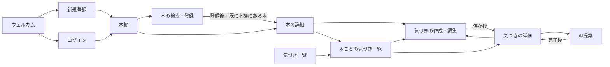

# book-app 要件定義書

この文書は、book-app で「何を、なぜ作るか」を定めます。技術を変えても変わらない内容（目的・機能・ルール・品質の条件）を扱い、作り方の細部は設計書で扱います。設計工程で使う技術的な決定事項は [設計メモ](design/notes.md) にまとめています。

## 目次

1. [目的・背景](#1-目的背景)
2. [用語の定義](#2-用語の定義)
3. [ターゲットユーザー](#3-ターゲットユーザー)
4. [スコープ](#4-スコープ)
5. [機能要件](#5-機能要件)
6. [ルール](#6-ルール)
7. [非機能要件](#7-非機能要件)
8. [技術的な前提](#8-技術的な前提)
9. [画面一覧と画面遷移（概要）](#9-画面一覧と画面遷移概要)
10. [既知の制限](#10-既知の制限)
11. [将来の拡張](#11-将来の拡張)

---

## 1. 目的・背景

### 課題

ビジネス書や自己啓発書を読んで気づきを得ても、行動に移せず、実生活に活かせないまま終わってしまう人が多い。

### 解決策

読書中・読了後の気づきを記録し、AIが問いかけ（深掘り）によって気づきを掘り下げ、具体的な行動プランにつなげる。

### 開発方針

- MVP（最小限の機能）を先に完成させ、段階的に機能を追加する。
- 将来の機能追加で全体に影響する要素（ユーザーごとのデータ管理、公開範囲など）は、MVPの時点から考慮しておく。
- 設計で迷った場合は、作る側の都合ではなく利用者にとっての使いやすさを優先する。

---

## 2. 用語の定義

画面に出す文言（エラー・お知らせ・ボタン名など）は、design/screens.md を正とする。この文書の例文と食い違う場合は screens.md に合わせる。

この文書では、次の用語を統一して使います（「」や『』で示した画面の表示文は原文のままとし、統一の対象外とします）。

| 用語       | 意味                                                                                 |
| ---------- | ------------------------------------------------------------------------------------ |
| 気づき     | 利用者が本を読んで書いた内容。                                                       |
| 深掘り     | 気づきに対して、AIが最初に返す質問。                                                 |
| 回答       | 深掘りに対する、利用者の答え。                                                       |
| 行動プラン | 気づき・深掘り・回答をもとに、AIが最後に返す、実生活で試せる具体的な行動（1〜3個）。画面での表示名は「次の一歩」。 |
| AI提案     | 深掘り → 回答 → 行動プランまでの、一連の流れ全体。                                   |

---

## 3. ターゲットユーザー

### 想定する利用者

ビジネス書・自己啓発書を読むが、学びを行動に移せていない20〜30代の社会人。

### 利用できる人

- 利用できるのは高校生以上。18歳未満は保護者の同意を得て利用する。
- 理由：ターゲットは社会人であり、中学生以下を対象にすると、未成年の個人情報の扱いや保護者の同意など、MVPの範囲を超える対応が必要になるため。

### 対応環境

- スマートフォンとパソコンのブラウザで使えるWebアプリとする（画面の幅に合わせて表示を変える）。
- 画面はスマートフォンを基準に作る。
- 対応ブラウザは Chrome と Safari の最新版。
- ストアで配布するスマートフォン用アプリは作らない。
- 理由：気づきは本を読みながらその場で書くことが多いため、スマートフォンで使えることが重要。パソコンで長い気づきを書く利用者や、パソコンで閲覧する採用担当者にも対応するため。

---

## 4. スコープ

### MVPの範囲

- ユーザー登録・ログイン・ログアウト・パスワード変更・退会
- 利用規約・プライバシーポリシーの表示と、登録時の同意
- 本の検索・登録・一覧・編集・削除、読書ステータスの変更
- 気づきの作成・編集・削除・一覧
- AI提案
- プロフィール（属性の変更）

### 段階的な拡張

| 段階    | 内容                                                                                                                                                                 |
| ------- | -------------------------------------------------------------------------------------------------------------------------------------------------------------------- |
| 第2段階 | パスワードを忘れた場合の再設定、メールアドレスの変更、メールアドレスの本人確認、気づきの横断検索・タグ、振り返り機能、ログイン状態の自動延長（リフレッシュトークン） |
| 第3段階 | 読了投稿の公開、いいね、フォロー（SNS機能）                                                                                                                          |

詳細は「[11. 将来の拡張](#11-将来の拡張)」を参照。

### MVPでは作らないこと

- 上記の第2・第3段階の機能
- AIとの複数往復の会話
- 深掘りへの回答を飛ばして行動プランだけを受け取る機能
- 回答を送る前に中断したAI提案を後から再開する機能
- AI提案を1件ずつ削除する機能
- 手入力の本の表紙画像のアップロード
- ISBNの手入力
- 読了日の記録

---

## 5. 機能要件

### 5.1 ユーザー

#### 登録・ログイン

- メールアドレスとパスワードで登録・ログインする。
- メールアドレスは大文字・小文字を区別せず、前後の空白を除いたうえで小文字にそろえて扱う。理由：大文字・小文字の違いだけで別のアカウントができたり、登録時と違う書き方で入力してログインできなくなったりするのを防ぐため。
- 同じメールアドレスでは1つのアカウントしか作れない。登録済みの場合は「このメールアドレスは既に登録されています」と表示する。理由：ログイン時に利用者を識別する情報としてメールアドレスを使うため。
- ログインに失敗した場合は「メールアドレスまたはパスワードが正しくありません」と表示する。どちらが誤っているかは伝えない。
  - 理由：登録済みのメールアドレスを第三者に推測させないため。
- MVPでは、メールアドレスが本人のものかどうかの確認は行わない。
  - 理由：確認にはメール送信の仕組みが必要で、パスワード再設定と同じくMVPの範囲を超えるため。

#### 属性

- 登録時に属性を必須で選択する：高校生／大学生・専門学生／社会人／主婦・主夫／その他。
- プロフィール画面から変更できる。
- 理由：属性に合ったAI提案にするため。

#### 利用規約・プライバシーポリシーへの同意

- 登録時に、利用規約とプライバシーポリシーへの同意を必須とする（同意のチェックがないと登録できない）。
- 理由：外部AIに利用者の入力を送るサービスであり、それを事前に伝えて同意を得るため（7章「セキュリティ・プライバシー」のとおり）。

#### パスワード

- パスワードは8〜128文字。文字種（大文字・記号など）の強制はしない。
  - 理由：8文字は一般的な最低ライン。上限を設けるのは、極端に長い入力によるサーバーへの負荷を防ぐため。文字種の強制より長さの確保が安全性に効果的で、利用者にも使いやすいため。
- パスワードの前後の空白は取り除いて扱う（途中の空白は残す）。
  - 登録・ログイン・パスワード変更・退会時の再入力のすべてで同じ扱いにし、画面だけでなくサーバー側でも必ず行う。
  - 文字数は取り除いた後で数える。
  - パスワードの入力欄の近くに「パスワードの前後の空白は取り除かれます」と表示する。
  - 理由：コピー＆ペーストで意図せず付いた空白のせいで、正しいパスワードでもログインできなくなるのを防ぐため。
- ログイン中は、現在のパスワードを入力したうえで、パスワードを変更できる。理由：パスワードが漏れた可能性があるときなどに、利用者が自分で変更できるようにするため。メール送信の仕組みが不要で、MVPでも実現できるため。現在のパスワードの入力を求めるのは、ログインしたまま席を外した場合などに、第三者にパスワードを変更されるのを防ぐため。

#### 退会

- プロフィール画面から、パスワードを再入力したうえで退会できる。
- 退会すると、本・気づき・AI提案など、そのアカウントのデータをすべて削除する。
- 退会前に「すべてのデータが削除され、元に戻せません」と確認を表示する。
- 理由：個人的な記録を預かるサービスとして、利用者が自分のデータを消せる手段が必要なため。パスワードの再入力は、ログインしたまま席を外した場合などに第三者に退会されるのを防ぐため。

#### ログアウト

- ログアウトできる。

### 5.2 本

#### 登録

- タイトルで外部の書籍検索サービス（Google Books）を検索し、候補から選んで登録する。見つからない場合は手入力で登録する。理由：検索から選ぶことで入力の手間が減り、表紙画像やISBNも自動で取得でき、タイトルの表記ゆれも防げるため。Google Books に見つからない本（新刊・マイナーな本など）も登録できるよう、手入力も残す。
- 本の情報：タイトル（必須）、著者（任意）、ISBN（任意）、表紙画像（任意）。
  - 著者を任意とする理由：Google Books には著者が登録されていない本があるため。
- 手入力で登録するときは、タイトルと著者だけを入力する。表紙には、こちらで用意した本のアイコン画像を使う。ISBNの入力欄は作らない。
  - 理由：手入力する本は Google Books に見つからなかった本であり、ISBNをわざわざ入力する利用者は少ないため。画像のアップロードは、保存場所や不正なファイル対策が必要になり、MVPの範囲を超えるため。
- Google Books の検索結果に表紙画像がない本も、同じアイコン画像を使う。理由：表紙のない本も、手入力の本と同じ見た目にそろえ、本棚の表示を統一するため。
- Google Books から登録する場合も、ISBNは任意とする（ある場合は保存する）。
  - 理由：ISBNが登録されていない本も多く、ISBNを必須にすると、検索結果に出る本を登録できなくなるため。

#### 重複の扱い

- 同じ本は、本棚に1回だけ登録できる。重複の判定には、Google Books が本ごとに付けている識別子を使う。
- すでに本棚にある本を登録しようとした場合は「この本は既に本棚にあります」と表示し、その本の詳細画面へ案内する。
- 理由：同じ本の気づきを1か所にまとめるため。ISBNはない本があり、タイトルは表記ゆれがあるため、識別子で判定する。
- 手入力で登録した本は、重複の判定を行わない。
  - 理由：タイトルの表記ゆれで正しく判定できないため。
- 本棚から削除した本は、もう一度登録できる。理由：本棚から削除した後に読み直す場合などに、もう一度登録できるようにするため。

#### 読書ステータス

- 読書ステータス：読書中／読了。登録時に選べ、後から変更できる。初期値は読書中。理由：第3段階の「読了投稿」は、読了という状態がないと作れないため。後から追加すると、それまでに登録した本の状態をどう扱うかを決め直す必要があるため、MVPの時点から持たせる。初期値を読書中にするのは、読みながら気づきを書くために登録する使い方が中心であるため。
- 読了日は記録しない（4章「MVPでは作らないこと」のとおり）。

#### 編集

- 手入力で登録した本だけ、タイトル・著者を編集できる。Google Books から登録した本は編集できない。
  - 理由：手入力時の打ち間違いを修正できるようにするため。Google Books から登録した本は打ち間違いが起きず、タイトルを書き換えられると、同じ識別子なのにタイトルが違う本ができてしまうため。第3段階で同じ本を探すときに、Google Books の正しい情報を使えるようにするため。
  - 手入力の本かどうかは、Google Books の識別子を持っていないことで判定する（Google Books の本には識別子が必ずある）。
  - 画面で編集の操作を出さないだけでなく、サーバーでも Google Books から登録した本の編集を受け付けない。
- 表紙とISBNは編集できない。理由：表紙を変えるには画像のアップロードが必要で、MVPの範囲を超えるため。ISBNは Google Books から取得した値だけを持たせ、第3段階で同じ本を正確に探せるようにするため。

#### 削除

- 本は削除できる。本を削除しても、その本に書いた気づきとAI提案は削除されずに残る。
- 削除前に「この本を本棚から削除しますか？この本の気づきは、気づき一覧に残ります」と確認を表示する。
- 理由：気づきは利用者自身の学びの記録であり、本棚の整理によって失われるべきではないため。

### 5.3 気づき

#### 作成

- 気づきは、作成時に必ず本を選んで書く。理由：読書の気づきを記録するアプリであるため。また、本の情報をAI提案で使うため。
- 1冊の本に複数の気づきを書ける。
- 気づきの本は、作成後に変更できない。
  - 理由：変更できると、本の情報のコピーや気づき一覧のまとめ方が複雑になるため。本を間違えた場合は、気づきを書き直してもらう。
- 気づきの内容：引用（任意）、ページ番号（任意）、本文（必須）。
- 気づきの登録・編集には、1日の回数制限はない。理由：気づきの記録には外部AIを使わず利用料金がかからないため。利用者の学びの記録を制限しないため。

#### 本の情報の記録

- 気づきは、作成時の本のタイトル・著者・表紙と、元の本を識別する情報を記録しておく。
- 本が本棚にある間に本のタイトル・著者を編集した場合は、気づき側の表示も自動で更新する。
- 本を削除した後は、削除時点のタイトル・著者・表紙で表示し続ける。
- 理由：本を削除した後も、どの本の気づきかを表示し、AI提案で本の情報を使えるようにするため。

#### 公開範囲

- 気づきには公開範囲（非公開／公開）を持たせる。
- 第3段階のSNS機能に備えたもので、MVPでは常に非公開とし、利用者は変更できない。

#### 編集・削除

- 気づきは編集・削除できる。
- 気づきを削除すると、その気づきのAI提案（次の一歩）も削除される。AI提案がある場合は、削除前に「この気づきの次の一歩（AI提案）も一緒に削除されます」と表示する。理由：AI提案は気づきに対する記録であり、気づきがなくなると何に対する提案かわからなくなるため。事前に知らせるのは、AI提案もまとめて削除されることを知らずに消してしまうのを防ぐため。
- 気づきを編集しても、過去のAI提案はそのまま残す。
  - 理由：AI提案は、その時点の気づきに対する記録として扱うため。

### 5.4 気づき一覧

- 気づき一覧には、本棚にあるすべての本（気づきが0件の本を含む）と、気づきのある削除済みの本を並べる。本ごとに「表紙・タイトル・気づきの数」を表示する。理由：気づきタブから、本棚を経由せずに気づきを書けるようにするため。気づきのない削除済みの本は、見せるものがないため並べない。
- 本をタップすると「本ごとの気づき一覧」画面に移り、その本の気づきを表示する。
  - 理由：気づき1件の文字数が多いため、一覧の中で開くとごちゃついて見づらくなるため。
- 削除済みの本は、元の本ごとに分けて並べ（同じタイトルの別の本と混ざらないようにする）、「本棚から削除済み」と表示する。削除済みの本も、同じように「本ごとの気づき一覧」画面で気づきを見られる。
- 同じ本を削除してから再登録した場合、古い気づきは新しい本に自動で付け直さない（削除済みの本と、本棚にある本の2つが並ぶ）。理由：別の版の本を選んで登録した場合などに、誤って結びつくおそれがあるため。付け直す機能は、元の本の情報を残してあるため、必要になれば後から追加できる。
- 気づき一覧の並び順は、次の3つから選べる。初めは「最近書いた順」とする。
  - 最近書いた順：その本で最後に気づきを作成した日時が新しい本から。気づきが0件の本は最後に、本棚に登録した日時が新しい本から。理由：最近気づきを書いた本ほど、続きを書いたり見返したりする可能性が高いため。
  - 気づきが多い順：気づきの件数が多い本から。同じ件数なら、最後に気づきを作成した日時が新しい本から。
  - 気づきが少ない順：気づきの件数が少ない本（0件）から。同じ件数なら、本棚に登録した日時が新しい本から。理由：まだ気づきを書いていない本を探せるようにするため。
- 本の詳細画面には、その本の気づきの件数と、「本ごとの気づき一覧」画面に移るボタンを置く。本の気づきを並べて表示するのは「本ごとの気づき一覧」画面の1か所だけとする。
  - 理由：同じ一覧を2か所で作ると、表示のずれや直し忘れが起きるため。

### 5.5 AI提案

#### 画面と状態

- AI提案は、気づきの詳細画面から、独立した「AI提案」画面に移って行う。理由：AI提案は、深掘り → 回答 → 行動プランと複数の段階があり、気づきの詳細と分けることで、利用者が1つの流れに集中でき、画面がごちゃつかないようにするため。
- AI提案の状態：**深掘りの作成中 → 回答待ち → 行動プランの作成中 → 完了**。文書全体でこの表記を使う。

#### 流れ

1. 利用者が気づきの詳細画面で「AI提案を受ける」を押す。
2. AI提案画面に移り、AIが深掘りを1つ作る。
3. 利用者が深掘りに回答する。
4. AIが気づき・深掘り・回答を踏まえて、行動プランを1〜3個作る。
5. 完了したAI提案を保存する。

- 行動プランを1〜3個とする理由：多すぎると、どれから手をつければよいか迷い、行動に移せなくなるため。ターゲットは行動に移せていない人なので、少数の具体的な行動に絞る。
- 1回のAI提案は1往復（深掘り1つ、回答1つ）で終わる。
  - 理由：何往復もできるようにすると、チャット機能を作るのと同じ規模になりMVPが膨らむため。また、往復の回数が決まっていると利用料金を見積もりやすく、利用者にとっても「行動プランが出たら完了」と終わりがわかりやすいため。
- 行動プランは、必ず深掘りに回答した後にのみ作られる。理由：利用者自身の回答（本音や状況）をもとにすることで、一般論ではなく、その人に合った具体的な行動プランにするため。回答を飛ばせると、深掘りの意味がなくなるため。
- 利用者の属性を踏まえた提案にする（例：社会人なら職場での行動、学生なら学校生活での行動）。
  - 理由：属性に合ったAI提案にするため（5.1「属性」のとおり）。

#### AI提案を始められる条件

- 新しいAI提案は、気づきの詳細画面で「AI提案を受ける」を押したときだけ始まる。
  - 理由：利用者の意図しない操作で回数が減るのを防ぐため。
- 同じ気づきで、深掘りの作成中または行動プランの作成中のAI提案があるときは、新しいAI提案を始められない。その場合は「この気づきのAI提案を処理中です。しばらくお待ちください」と表示する。
  - 理由：AIが処理している最中の結果が別の操作で失われ、利用料金だけがかかるのを防ぐため。
- 同じ気づきで、回答待ちのAI提案があるときに新しいAI提案を始めた場合は、回答待ちのAI提案は削除される。理由：回答しなかったAI提案は残さない、というルールに合わせるため。未回答のAI提案がたまらないようにするため。
- 1つの気づきに対して、何回でもAI提案を受けられる（6章の利用制限の範囲内）。ただし、保存して表示するのは、最新の完了したAI提案1つだけとする（下の「保存するAI提案の数」）。理由：AI提案の結果が合わなかった場合や、行動してみてうまくいかなかった場合に、もう一度AI提案を受けられるようにするため。料金は1日の回数制限で抑えられるため。
- すでに完了したAI提案がある気づきで新しいAI提案を始めるときは、「新しいAI提案が完了すると、今の次の一歩は新しいものに置き換わり、元には戻せません。途中でやめた場合は、今の次の一歩が残ります」と確認を表示する。理由：置き換えた後に元に戻せないことを、始める前に知らせるため。

#### AI提案画面を開き直した場合

AI提案画面を再読み込み・ブラウザの戻る/進む・URLの直接入力で開いても、新しいAI提案は始まらない（理由：利用者の意図しない操作で回数が減るのを防ぐため）。そのときは、AI提案の状態に応じて次のように表示する。

| AI提案の状態                                                                   | 表示                                                                       |
| ------------------------------------------------------------------------------ | -------------------------------------------------------------------------- |
| 完了                                                                           | 結果を表示する。                                                           |
| 行動プランの作成中 | 作成中であることと、完了すると気づきの詳細に表示されることを伝える（文言は design/screens.md「8. AI提案」） |
| 深掘りの作成中・回答待ち（行動プランの作成に失敗して回答待ちに戻った後も含む） | 「このAI提案は終了しました」と表示し、気づきの詳細画面に戻るボタンを出す。 |
| 削除済み                                                                       | 「このAI提案は終了しました」と表示し、気づきの詳細画面に戻るボタンを出す。 |

- 深掘りの作成中・回答待ちのAI提案を「終了しました」とする理由：回答を送る前に画面を離れたAI提案は削除する、というルールに合わせるため（再読み込み・戻る・URLの直接入力は「画面を離れた」に含める）。
- あわせて、開き直した時点でそのAI提案を終了させる。
  - 回答待ちの場合：削除する。回数は戻らない。
  - 深掘りの作成中の場合：終了扱いにし、AIが後から深掘りを作り終えても保存しない。AIの成否にかかわらず回数は戻らない。
  - 終了させる処理は、画面を開いたときに画面からサーバーへ明示的に伝える。詳細は設計書で扱う。
- 終了したAI提案に回答を送った場合は「このAI提案は終了しました。気づきの詳細から新しく始めてください」と表示する。

#### 気づきの内容の記録

- AI提案を始めた時点の気づき（本文・引用）の内容を、AI提案と一緒に記録する。流れの④でAIに渡す気づきの本文・引用は、この記録した内容とする。
- 理由：途中で気づきを編集しても、深掘りと前提が食い違わないようにするため。また、後からAI提案を見返したときに、どの内容に対するAI提案だったかがわかるようにするため。

#### 保存と削除

- 保存されるのは、行動プランまで完了したAI提案だけとする。
  - 理由：完了しなかったAI提案の再開や一覧表示をなくし、「完了したものだけが残る」という単純なルールにするため。
- 回答を送る前（深掘りの作成中・回答待ち）にAI提案画面を離れると、そのAI提案（深掘りと入力中の回答を含む）は削除される。使った回数は戻らない。
  - 理由：回数を戻すと、「始めて深掘りだけ見て離れる」を繰り返すことで深掘りを無制限に受け取れてしまい、利用料金の歯止めにならないため。また、完了しなかったAI提案の再開や一覧表示をなくし、「完了したものだけが残る」という単純なルールにするため。
- 「画面を離れる」とは、アプリ内の別の画面へ移る、ページを再読み込みする、タブやブラウザを閉じる、のいずれかを指す。スマートフォンで別のアプリに切り替える、画面をロックする、は画面を離れたことにしない（ただし、ブラウザがページを自動で閉じた場合は、再読み込みと同じ扱いになる場合がある）。
  - 理由：通知の確認や、回答を考えるためにほかのアプリを見るのは自然な行動であり、そのたびにAI提案が消えると使いにくいため。
- 回答待ちのまま24時間たったAI提案は削除する。削除された後に回答を送った場合は「このAI提案は終了しました。気づきの詳細から新しく始めてください」と表示する。
  - 理由（24時間）：回答を考えたり通知を確認したりする時間を十分に確保しつつ、完了しないデータをいつまでも残さないため。
- 回答を送った後（行動プランの作成中）は、画面を離れても行動プランの作成を続け、完了すれば保存される（前のAI提案があれば置き換える）。削除の対象は「回答を送らずに離れたAI提案」に限る。
  - 理由：回数を使い、回答まで送っているので、結果が残るほうが利用者にとって自然なため。
- 回答を送る前に画面を移ろうとした場合は、「このAI提案は削除されます。（深掘りと、入力した回答も削除されます）使った回数は戻りません。移動しますか？」と確認を表示する。行動プランの作成中は、この確認を表示しない。理由：意図せず画面を移って、使った回数を無駄にする事故を減らすため。行動プランの作成中は、離れてもAI提案が削除されないため、確認は不要。

#### 失敗した場合

- ④の行動プランの作成に失敗した場合は、画面にいる間なら「もう一度送る」で回答を送り直せる（回数は使わない）。理由：失敗はAI側やシステム側の原因で起きるものであり、利用者に回数を負担させないため。回答を書き直さずに送り直せるようにするため。

#### 保存するAI提案の数

- 1つの気づきに保存するAI提案は、最新の完了した1つだけとする。完了したAI提案は、気づきの詳細画面から見返せる。
- 新しいAI提案が完了したときに、前の完了したAI提案を削除して置き換える。新しいAI提案が完了しなかった場合（途中で離れた、失敗した、など）は、前のAI提案が残る。
  - 理由：もう一度AI提案を受けたいと思うのは、前の結果が合わなかったときであり、残すのは最新の1つで十分なため。画面も単純になるため。置き換えを完了したときに限るのは、新しいAI提案が途中で終わった場合に、何も残らなくなるのを防ぐため。
- 置き換えても、使った回数は戻らない。

---

## 6. ルール

### 6.1 入力の上限

| 項目           | 上限               | 理由                                                                                                  |
| -------------- | ------------------ | ----------------------------------------------------------------------------------------------------- |
| 気づきの本文   | 必須、1000文字まで | 本の内容と自分の経験を結びつけて書くには、500文字では窮屈なため。                                     |
| 引用           | 300文字まで        | 本の一節を引用するには十分な長さで、本文より短くして本文を主役にするため。                            |
| 深掘りへの回答 | 必須、500文字まで  | 1つの質問への答えなので、気づきの本文ほど長くならないため。また、AIに送る量（利用料金）を抑えるため。 |
| 本のタイトル   | 必須、200文字まで  | 長い副題がついた本でも収まるため。                                                                    |
| 著者           | 任意、100文字まで  | 共著の本でも収まるため。                                                                              |
| メールアドレス | 254文字まで        | メールアドレスの仕組み上の一般的な上限であるため。                                                    |
| ページ番号     | 1〜9999の整数      | 現実的な本のページ数を網羅できるため。                                                                |

- 文字数は前後の空白を除いてから数える。空白だけの入力は未入力として扱う。理由：意図せず入った空白で文字数がずれたり、空白だけの気づきや回答が登録されたりするのを防ぐため。
- 絵文字なども含め、見た目の1文字を1文字として数える（画面とサーバーで同じ数え方にする。数え方の詳細は設計書で扱う）。
  - 理由：画面とサーバーで数え方が違うと、画面では上限内なのにサーバーでエラーになるずれが起きるため。
- パスワードの文字数と前後の空白の扱いは、5章「5.1 ユーザー」のとおりとする。
- 入力の上限を設ける理由：外部AIに送る量（利用料金）を抑えるため、入力チェックとテストを可能にするため、画面の表示崩れを防ぐため。

### 6.2 AI提案の利用制限

#### 1人あたりの上限

- 1人あたり1日5回まで。日本時間の0時に回数が回復する。
- 理由：外部AIの利用料金を抑えるため。1日5回あれば、通常の読書での使い方には十分なため。日本時間の0時にするのは、ターゲットが日本の利用者であるため。

#### 回数の数え方

- AIが深掘りを作ることに成功した時点で1回として数える。その1回には、④の行動プランの作成まで含む。理由：利用者から見て「深掘りが表示されたら1回使った」とわかりやすいため。行動プランは同じ流れの続きであり、別に数えると1回のAI提案で2回分減ってしまうため。
- AIが深掘りの作成に失敗した場合（2分経過で止まったとみなした場合を含む）は、個人の回数とアプリ全体の回数のどちらも消費しない。
  - 理由：片方だけ戻すと、回数の記録がずれていくため。
  - 例外：深掘りの作成中にAI提案画面を開き直して終了させた場合は、AIの成否にかかわらず回数は戻らない（5章「AI提案画面を開き直した場合」のとおり）。
- ④の行動プランの作成に失敗した場合は、画面にいる間であれば、回数を消費せずに回答を送り直せる。理由：失敗はAI側やシステム側の原因で起きるものであり、利用者に回数を負担させないため。
- 次のAI提案は、いずれもその日の消費回数は戻らない。
  - 回答を送る前に画面を離れて削除されたAI提案（理由：5章「保存と削除」のとおり）
  - 回答待ちのまま24時間たって削除されたAI提案（理由：深掘りを受け取った時点でAIの利用料金は発生しているため。回答を送る前に離れた場合と同じ扱いにするため。）
  - 気づきの削除によって削除されたAI提案（理由：AIの利用料金はすでに発生しているため。戻すと、AI提案を受けてから気づきを削除することを繰り返して、回数制限をすり抜けられてしまうため。）
  - 退会によって削除されたAI提案（理由：退会すると個人の回数の記録自体を削除するため。アプリ全体の回数は退会しても減らさない（6.2「アプリ全体の上限」のとおり）。）

#### 同時操作の扱い

- 同じ気づきで深掘りまたは行動プランを作成している最中は、新しいAI提案を始められない（5章のとおり）。
- ボタンの連打や複数の画面からの同時操作があっても、1回の操作で回数を2回以上消費してはならず、1日5回を超えて利用できてはならない。
  - 理由：利用者から見て「1回押しただけなのに2回減った」という不具合を防ぐため。また、利用料金に直結するため。
- 1回の回答送信について、行動プランの作成処理が同時に2つ以上動いてはならない（AIの呼び出しは、自動再試行を含めて最大2回）。
  - 理由：利用料金に直結するため。最大2回は、7章のとおり失敗時に1回だけ自動で再試行するため。

#### アプリ全体の上限

- アプリ全体でも、全利用者の合計で1日100回までとする（日本時間の0時に回復）。
- アプリ全体の回数は、誰が使ったかを含まない形で記録し、退会しても減らない。
- 理由：アカウントを大量に作成して個人の制限をすり抜けることを防ぎ、利用料金を管理するため。
- 100回という値の理由：1人1日5回×20人分であり、ポートフォリオの段階で想定する利用者数（十数人程度）でも足り、それを超える量は不正な利用とみなして止めるため。また、1日の最大費用をこの回数で見積もれるため。
- アプリ全体の月の利用上限額を、AIサービス側の管理画面でも設定する。
  - 理由：アプリ側の制限が破られた場合の最終的な歯止めとするため。

### 6.3 不正利用の防止

- ログインの試行は、同じ接続元から1分間に5回までとする。超えた場合は、試行回数が多すぎることと、1分ほど待ってから試すよう表示する（文言は design/screens.md「10. 新規登録・ログイン」）。
  - 理由：パスワードの総当たり攻撃を防ぐため。
  - 5回という値の理由：パスワードの打ち間違いは通常2〜3回程度なので、5回あれば利用者は困らず、10回では多いと判断したため。
  - 1分間という値の理由：パスワードの総当たりを大きく遅らせつつ、打ち間違えた利用者を長く待たせないため。同じ接続元からは、1日に試せる回数が最大でも約7,200回（5回×60分×24時間）に抑えられる。
- 新規登録は、同じ接続元から1時間に5件までとする。
  - 理由：アカウントの大量作成を防ぐため。
  - 5件という値の理由：通常、利用者は1回しか登録しない。入力ミスのやり直しや、家族・職場で同じネットワークを使う場合を考えても5件あれば足り、それ以上はアカウントの大量作成とみなせるため。
  - 1時間という値の理由：アカウントの大量作成を十分に遅らせつつ、正当な利用者が制限にかかった場合でも長く待たせないため。
- 具体的な仕組みは設計書で扱う。

### 6.4 削除時の扱い

- 本を削除しても、気づき・AI提案は残る。
- 気づきを削除すると、その気づきのAI提案も削除される。
- 回答を送る前に画面を離れたAI提案は削除される。回答待ちのまま24時間たったAI提案も削除される。回答を送った後に画面を離れたAI提案は削除されない。
- AI提案画面を開き直したとき、深掘りの作成中・回答待ちのAI提案は終了させる（5章「AI提案画面を開き直した場合」のとおり）。
- 退会すると、そのアカウントのデータ（本・気づき・AI提案・個人のAI利用回数）をすべて削除する。

各ルールの理由は5章のとおり。

### 6.5 データの持ち主

- アカウントに紐づくデータ（本・気づき・AI提案）は、そのアカウントの持ち主だけが閲覧・変更・削除できる。

---

## 7. 非機能要件

### 7.1 セキュリティ・プライバシー

#### パスワードとログイン状態

- パスワードは復元できない形で安全に保存する。理由：万一データベースの内容が漏れても、パスワードそのものを知られないようにするため。同じパスワードを使い回している利用者の、他のサービスへの被害を防ぐため。
- ログイン状態は7日間保持する。7日を過ぎると、もう一度ログインが必要になる。
  - 理由：読書中に気づいたことをすぐ書けるよう、毎日のログインは求めないため。一方で、扱う情報は決済などほど重要ではないものの、ログイン情報が盗まれた場合に使われ続ける期間を短く抑えるため、30日などの長期間にはしない。ログイン情報をブラウザのスクリプトから読み取れない形で保持し、パスワード変更時には一斉に無効化するため、7日間でも安全性とのバランスが取れると判断した。
- ログアウトすると、そのブラウザのログイン状態を削除する。
- パスワードを変更すると、それまでに発行したログイン状態をすべて無効にする（他の端末も含めて、ログインし直しが必要になる）。
  - 理由：パスワードを変更したのに、乗っ取った第三者が使い続けられる状態を防ぐため。

#### 攻撃への対策

- 他のサイトからの、利用者になりすました操作（CSRF）を防ぐ。理由：ログイン情報をブラウザのCookieで保持するため、他のサイトから利用者になりすまして操作される危険があるため。
- ログイン情報をブラウザのスクリプトから読み取れない形で保持する。
  - 理由：XSSによる盗難対策のため。
- 他人のデータには一切アクセスできない。
- 通信はすべてHTTPSで行う。理由：通信の途中でパスワード・ログイン情報・気づきの内容を盗み見られたり、書き換えられたりするのを防ぐため。ログイン情報をHTTPSのときだけ送る設定にするためにも必要。

#### 外部AIに送る情報

- 外部AIに送る情報は、本のタイトル・著者、引用、気づきの本文、利用者の属性、（④のみ）深掘りと回答に限る。
- ページ番号、メールアドレスやパスワードなどのアカウント情報、過去のAI提案の履歴は送らない。
- 理由：外部サービスに渡すデータを最小限にするため。
- 気づき・引用・回答の入力内容は外部AIに送られることを、画面上に明記する。例：「入力内容はAI（OpenAI）に送信されます。個人情報は書かないでください」。理由：利用者が、自分の入力がどこに送られるかを知ったうえで書けるようにするため。

#### 利用規約・プライバシーポリシー

- 利用規約とプライバシーポリシーを用意する。どちらもポートフォリオ向けの簡易版とする。
- プライバシーポリシーには、次を記載する。
  - 集める情報（メールアドレス、属性、本・気づき・AI提案の内容）
  - 利用目的
  - 入力内容を外部AI（OpenAI）に送信すること
  - 退会時にすべてのデータを削除すること
- 利用規約には、次を記載する。
  - 利用対象（高校生以上、18歳未満は保護者の同意が必要）
  - 禁止事項
  - サービスの変更・停止があり得ること
- 理由：外部AIに利用者の入力を送るサービスであり、それを事前に伝えて同意を得るため。

#### エラーの詳細

- エラーの詳細（内部情報）は画面に表示せず、サーバーの記録にのみ残す。理由：内部の情報（システムの構造や設定など）を、攻撃者の手がかりにさせないため。

### 7.2 応答時間

- AIへの1回の呼び出しは、最大30秒待つ。
  - 理由：AIの生成には数秒〜十数秒かかることがあり、短すぎると正常な処理まで失敗扱いになるため。
- 1回目の呼び出しが失敗した場合（時間切れ、AI側の一時的な不調、通信の失敗、返事の形式が不正など）は、1回だけ自動で再試行する。再試行しても直らない失敗（AIサービスの利用上限額に達した場合など）は再試行しない。
  - 理由：一時的な失敗の多くは再試行で解決するが、何度も繰り返すと料金と待ち時間が増えるため。
- 深掘りの作成・行動プランの作成のそれぞれで、利用者の待ち時間は最大約60秒となる。
  - 理由：30秒の呼び出しを、失敗時に1回だけ再試行するため（30秒×2）。
- 深掘りの作成中、または行動プランの作成中のまま2分が経過した場合は、処理が途中で止まったとみなす。
  - 深掘りの作成中の場合は失敗として扱い、回数を戻す。
  - 行動プランの作成中の場合は回答を送り直せる状態に戻す。
  - 理由：最大待ち時間（約60秒）の2倍の余裕を持たせ、正常に処理中のものを誤って止まったと判断しないため。サーバーの再起動などで処理が止まった場合に、利用者が先に進めなくなるのを防ぐため。

### 7.3 エラー時の表示

- AIの処理中は、ボタンを押せない状態にして「AIが質問を考えています…（最大1分ほどかかります）」のように処理中であることを表示する。理由：AIの処理は最大1分ほどかかることがあり、処理中であることを伝えないと、利用者が止まったと思って離れてしまうため。また、連打による二重送信を防ぐため。
- 次の場面では、何が起きたかと、いつ・どうすればよいかを表示する。画面に出す文言は design/screens.md（「6. 気づきの詳細」「8. AI提案」）を正とする。
  - AIの処理に失敗した場合
  - 1人あたりの1日の上限に達した場合（明日0時に回復することを伝える）
  - アプリ全体の1日の上限に達した場合（本人の回数ではなく、アプリ全体の都合で止まっていることがわかるようにする）

- 気づきの詳細画面に、その日のAI提案の残り回数を表示する。あわせて、制限はAI提案だけにかかり、気づきの登録は何件でもできることがわかるように表示する（例：「AI提案：本日あと3回（気づきの登録は何件でもできます）」）。
  - 理由：利用者が、気づきの登録も1日5件までと誤解しないようにするため。

---

## 8. 技術的な前提

| 区分           | 技術                                                                                                 | 選定理由                                                                                                                                                                                                                                                                                                                                                            |
| -------------- | ---------------------------------------------------------------------------------------------------- | ------------------------------------------------------------------------------------------------------------------------------------------------------------------------------------------------------------------------------------------------------------------------------------------------------------------------------------------------------------------- |
| バックエンド   | Python / FastAPI                                                                                     | AI連携に使うOpenAIの公式ライブラリが使いやすく、外部APIを非同期で呼び出しやすく、API仕様書を自動生成できるため。                                                                                                                                                                                                                                                    |
| データベース   | PostgreSQL                                                                                           | ユーザー・本・気づき・AI提案という関連のあるデータを扱うため。                                                                                                                                                                                                                                                                                                      |
| フロントエンド | React＋TypeScript                                                                                    | 前回のアプリで使った技術であり、AIに実装を任せる場合でも、生成されたコードを読んで理解しやすいため。TypeScriptは型があるため、APIとのやり取りの食い違いに気づきやすい。フロントエンドはAIを活用して実装し、開発者はバックエンドに注力する。構成の詳細は設計書で扱う。                                                                                               |
| 外部サービス   | OpenAI API（AI提案）、Google Books API（本の検索）                                                   | OpenAI API は、AI提案の深掘りと行動プランの生成に使う（Pythonの公式ライブラリがある）。Google Books API は、無料で本の検索ができ、前回のアプリで使った経験があるため。                                                                                                                                                                                              |
| インフラ       | Dockerで開発し、AWS（EC2）に公開する。画面とAPIは同じドメインから配信し、独自ドメインとHTTPSを使う。 | Dockerは、ローカルでも本番と同じ構成で開発でき、本番でだけ起きる問題を早く見つけられるため。EC2は、サーバーの構築や設定を自分で行い、インフラの基礎を身につけるため。画面とAPIを同じドメインから配信するのは、ログイン情報のCookieをそのまま使え、CSRF対策を単純にできるため。独自ドメインとHTTPSは、HTTPSの自動化と、ログイン情報をHTTPSのときだけ送る設定のため。 |

### テスト

- バックエンドのAPIについて、正常系と異常系（境界値を含む）の自動テストを書き、変更のたびに自動で実行する。
- 特に次を確認する。
  - 他人のデータにアクセスできないこと
  - 認証
  - AI提案の利用制限
  - 本・気づきの基本操作

---

## 9. 画面一覧と画面遷移（概要）

### 画面一覧（MVPは12画面＋モーダル2つ）

| No. | 画面 | 主な内容 |
| --- | --- | --- |
| 1 | ウェルカム | アプリ名・キャッチコピー・使い方の見本、「はじめる（新規登録）」「ログイン」、利用規約・プライバシーポリシー |
| 2 | 新規登録 | メールアドレス、パスワード、属性、利用規約・プライバシーポリシーへの同意 |
| 3 | ログイン | メールアドレス、パスワード |
| 4 | 本棚（トップ） | 登録した本の一覧。表紙・タイトル・読書ステータスを表示 |
| 5 | 本の検索・登録 | 書籍検索と手入力、登録時の読書ステータスの選択 |
| 6 | 本の詳細 | 本の情報、読書ステータスの変更、本の編集・削除、この本の気づきの件数、「気づきを書く」「この本の気づきを見る」ボタン |
| 7 | 気づき一覧 | 本の一覧（気づき0件の本を含む。表紙・タイトル・気づきの数）。並び順を3つから選べる |
| 8 | 本ごとの気づき一覧 | 1冊の本の気づきを並べて表示 |
| 9 | 気づきの作成・編集 | 引用・ページ番号（任意）、本文（必須） |
| 10 | 気づきの詳細 | 気づきの内容、気づきの編集・削除、次の一歩（最新のAI提案）、「AI提案を受ける」ボタン、本日の残り回数 |
| 11 | AI提案 | 深掘りの作成中 → 深掘りの表示と回答の入力 → 行動プランの作成中 → 行動プランの表示。外部AIへの送信に関する注意書き。AI提案ごとに画面を分け、完了したAI提案の見返しにも使う |
| 12 | プロフィール | 属性の変更、パスワードの変更、表示（自動・夜・朝）の切り替え、ログアウト、退会 |
| モーダル | 利用規約 | ウェルカム・新規登録・プロフィールから開く |
| モーダル | プライバシーポリシー | ウェルカム・新規登録・プロフィールから開く |

- 利用規約・プライバシーポリシーは画面を分けず、モーダルで開く。理由：新規登録の途中で開いても、入力した内容を失わずに戻れるため。
- 画面ごとの詳しい設計は [design/screens.md](design/screens.md) で扱う。

### 画面遷移（概要）

- ログインしていない人が開く最初の画面はウェルカム。ウェルカム → 新規登録／ログイン
- 新規登録・ログイン → 本棚
- 本棚 → 本の検索・登録／本の詳細
- 本の検索・登録 → 登録後は本の詳細（既に本棚にある本の場合も本の詳細へ案内）
- 本の詳細 → 気づきの作成／本ごとの気づき一覧
- 気づき一覧 → 本ごとの気づき一覧 → 気づきの作成／気づきの詳細
- 気づきの作成・編集 → 保存後は気づきの詳細
- 気づきの詳細 → 気づきの編集／AI提案
- AI提案 → 完了後は気づきの詳細へ戻る
- 本棚・気づき一覧・プロフィールは、ログイン中のどの画面からも移動できる（気づきの作成・編集画面とAI提案画面を除く。長い文を書くことや回答に集中してもらい、押し間違えて移ることで書きかけの内容やAI提案が失われるのを防ぐため。どちらの画面からも左上のボタン（「×」、AI提案の見返しでは「＜」）で戻れる）
- 利用規約・プライバシーポリシーは、ウェルカム・新規登録・プロフィールからモーダルで開く。ログインしていなくても閲覧できる
- ログインしていない、またはログインの有効期限が切れた場合はログイン画面に移動する
- パスワード変更後・退会後はログイン画面に移動する
- ボタン単位の詳しい遷移とワイヤーフレームは [design/screens.md](design/screens.md) で扱う

---

## 10. 既知の制限

MVPの時点で許容するもの。

- パスワードを忘れた場合、MVPでは復旧できない（第2段階でメールによる再設定を追加する）。
- メールアドレスの本人確認をしないため、他人のメールアドレスで登録できてしまう。その場合、本来の持ち主はそのメールアドレスで登録できない（第2段階で本人確認を追加する際に、既存アカウントの扱いを決める）。
- ログアウト前にログイン情報が盗まれていた場合、そのログイン情報は有効期限（最長7日）まで使える可能性がある（第2段階のリフレッシュトークン導入時に改善する）。
- Google Books では、同じ本でも版や出版社の違いで別の本として扱われることがあるため、同じ本を2回登録できてしまう場合がある。
- ログインの試行制限は接続元ごとに行うため、会社や学校など同じネットワークを共有する環境では、他の人の失敗に巻き込まれて制限がかかる場合がある。
- 登録時に、そのメールアドレスが既に登録されているかどうかがわかる。
- 退会して同じ日に再登録すると、その日のAI提案を再び5回まで使える。
  - 理由：退会時にすべてのデータを削除する方針と両立させるため。新規登録の回数制限とアプリ全体の上限があるため、影響は小さい。
- 回答を送る前にAI提案画面を離れると、AI提案は削除され、使った回数は戻らない。タブやブラウザを閉じる場合は、確認を表示できないことがある。また、スマートフォンで別のアプリを長く使っていると、ブラウザがページを自動で閉じ、戻ったときにAI提案が終了している場合がある（端末やブラウザによって動きが異なる）。
- AIサービスの障害が長く続いた場合、行動プランの作成に失敗し続け、画面を離れると回答が失われる。
- ログインの試行制限は接続元ごとに行うため、たくさんの接続元から同じアカウントのパスワードを試された場合は止めきれない（アカウントごとの制限は、他人が意図的にロックできてしまうため MVP では入れない。第2段階で検討する）。
- Google Books から追加した本は、利用者の本棚に入れた本の最小限の書誌情報（識別子・タイトル・著者・ISBN・表紙の URL）を保存する。Google の API の利用規約は API の内容の永続的な保存を制限しており、解釈に幅があるため、完全に安全とは言い切れない（問題になった場合は、識別子だけを保存する形に変える）。
- Google Books のタイトル・著者が上限（200文字・100文字）を超える本は、切り詰めて保存する。
- 「AI提案を受ける」を押した直後に通信が切れ、自動の送り直しも失敗した場合、深掘りを受け取れないまま本日の回数を1回使うことがある（サーバーには届いたが、返事だけが届かなかった場合。めったに起きないため許容する）。
- 読書ステータスを読了から読書中に戻しても、再読の履歴は残らない。
- Google Books から登録した本の情報（タイトル・著者）に誤りや不足があっても、利用者は直せない。手入力で登録し直すことはできるが、元の本に書いた気づきは元の本に付いたまま残る。

---

## 11. 将来の拡張

### 第2段階

- パスワード再設定（メール送信。候補：Amazon SES）
- メールアドレスの変更と本人確認
- 気づきの横断検索・タグ
- 振り返り機能
- リフレッシュトークン

### 第3段階

- 読了投稿の公開、いいね、フォロー
- ISBNは「同じ本を読んだ人」を探すために使う。
- 気づきの公開範囲はこの段階で使う。
